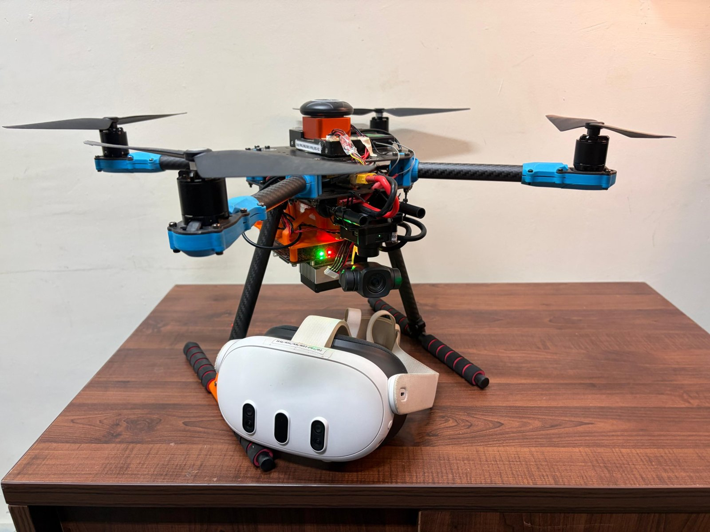
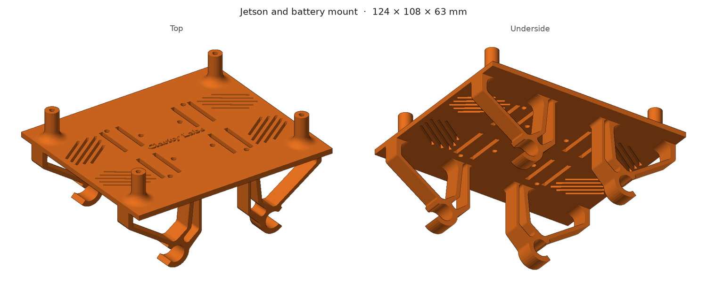

# AeroSense VR Drone

A quadcopter with a gimbal camera that you look through using a Meta Quest 3. Put the headset on and you see
what the drone sees, live, and the camera turns wherever you turn your head. A Jetson on the drone runs person
detection on the video at the same time, so the headset can show you where people are.

Built as a Design Credit project at Clarity Lab, CSE, IIT Jodhpur (2026), under Prof. Hardik Jain. We got the headset
steering the gimbal on the bench, designed a mount, moved the whole system onto the drone and flight-tested it.



```
SIYI A8 mini ──Ethernet──► Jetson (video server, YOLOv8n, MiDaS, SAM2) ──Tailscale──► Quest 3 app
      ▲                                                                                  │
      └──────────── gimbal_controller.py ◄──────── head yaw / pitch ─────────────────────┘
```

## Repository structure

| Folder | What's in it | Start here if you want to... |
|---|---|---|
| [`Assets/`](Assets/) | The Unity project for the Quest app (scripts in `Assets/Scripts/`, scene in `Assets/Scenes/`) and the two Jetson scripts in `Assets/jetson files/` | change what the headset shows or how it talks to the drone |
| [`cad/`](cad/README.md) | The 3D-printed Jetson and battery mount, as a SolidWorks part and an STL | print or modify the mount |
| [`tools/`](tools/) | `gimbal_test.py` for checking the gimbal on its own, and the Linux build fix | debug the gimbal or build on Ubuntu |
| [`docs/`](docs/progress-report.md) | Progress report: what works, what we measured, future work | see what was tested and measured |

## Quick start

First put your own addresses in, since the repo ships with placeholders (see [Network](#3-network)).

On the Jetson, in two terminals:

```bash
python3 ~/gimbal_controller.py
python3 ~/a8_stream_server.py
```

Open `http://<jetson-ip>:8080/stream` in a browser to check the video. Then on the Quest, switch Tailscale on,
open **VR Drone Aerosense** from App Library → Unknown Sources, look straight ahead and press **A**.

---

## 1. How it works

The SIYI A8 mini streams H.265 video over Ethernet to the Jetson. `a8_stream_server.py` decodes it on the
Jetson's hardware decoder, runs YOLOv8n to find people, MiDaS to estimate how far away they are and SAM2 to get
their outlines, and serves everything over HTTP on port 8080.

The Quest app shows the video and sends your head's yaw and pitch back to the Jetson on UDP port 5005.
`gimbal_controller.py` turns those angles into SIYI SDK commands and sends them to the gimbal on port 37260.

The **A** button switches between two modes. Camera feed mode shows the live video and lets your head steer the
gimbal. Passthrough mode shows your real surroundings with green outlines of the people the drone has found.

## 2. Hardware

| Part | What it does |
|---|---|
| SIYI A8 mini | 3-axis gimbal camera, mounted upside down under the drone. Connected to the Jetson over Ethernet |
| NVIDIA Jetson | Onboard computer. Runs the video server, detection and gimbal control |
| Jetson and battery mount | Our 3D-printed mount, clips onto the frame tubes. See [`cad/`](cad/README.md) |
| Meta Quest 3 | Runs the app |
| Flight controller | ArduPilot (not yet talking to the Jetson) |



**Upside-down camera:** because the camera hangs upside down, the Jetson scripts correct for it.
`gimbal_controller.py` has `YAW_SIGN` and `PITCH_SIGN` near the top so the gimbal follows your head the right way,
and `a8_stream_server.py` rotates the picture 180°. If you ever remount the camera, flip `YAW_SIGN` or
`PITCH_SIGN` between `1` and `-1` and restart the controller. No app rebuild needed.

## 3. Network

Everything talks over one Tailscale network. The repo has placeholders instead of real addresses, so fill them
in before running anything:

| Placeholder | Where it is | What to put |
|---|---|---|
| `JETSON_IP_HERE` | Four scripts in `Assets/Scripts/` and `SampleScene` | The Jetson's Tailscale address |
| `CAMERA_IP_HERE` | `a8_stream_server.py`, `gimbal_controller.py`, `tools/gimbal_test.py` | The A8 mini's address on the Ethernet link |

This fills in the Jetson address everywhere in the Unity project (use the same command to change it later):

```bash
grep -rl "JETSON_IP_HERE" Assets | xargs sed -i 's/JETSON_IP_HERE/<jetson-ip>/g'
```

Two things we learned the hard way:

- Put the Jetson and the Quest on the **same Wi-Fi or hotspot**. Tailscale then connects them directly. When it
  had to go through a relay, delay went past 600 ms, which makes head tracking useless.
- On Ubuntu laptops, **turn off Wi-Fi power saving**. It was adding 100–250 ms of random delay:

```bash
sudo sed -i 's/wifi.powersave = 3/wifi.powersave = 2/' /etc/NetworkManager/conf.d/default-wifi-powersave-on.conf
sudo systemctl restart NetworkManager
```

## 4. Testing the gimbal without the headset

Send it an angle from any machine on the network (yaw 30°, pitch 0°):

```bash
python3 -c "import socket;s=socket.socket(2,2);s.sendto(b'30,0',('<jetson-ip>',5005))"
```

If that doesn't move it, stop the controller and run `tools/gimbal_test.py` on the Jetson. It talks to the gimbal
directly and prints every reply and the angles the gimbal reports, so you can tell a gimbal problem from a network
problem.

The Jetson runs its scripts from its home folder. After changing one there, copy it back into the repo:

```bash
scp <user>@<jetson-ip>:~/a8_stream_server.py <user>@<jetson-ip>:~/gimbal_controller.py "Assets/jetson files/"
```

## 5. Building the Quest app

You need **Unity 2022.3.62f2** exactly, with Android Build Support, OpenJDK, and Android SDK & NDK Tools.
Don't open the project in Unity 6, and say no if Unity offers to upgrade the Meta XR SDK past 201.

1. Open the project in Unity.
2. File → Build Settings → Android → Build, and save as `Builds/drone.apk`.
3. With the Quest plugged in over USB and developer mode on:

```bash
adb install -r Builds/drone.apk
```

The app installs as `com.aerosense.vrdrone`.

**Building on Ubuntu:** the Meta XR SDK 201 has a bug that only shows up in the Linux editor. You get an
`ArgumentOutOfRangeException` every 5 seconds and the build fails. Open the project once, close Unity, then run:

```bash
bash tools/patch_meta_sdk_linux.sh
```

It makes a patched local copy of the SDK in `Packages/` (gitignored). Windows doesn't need this.

## 6. Flight test

We flew the drone with the full system on board and it worked well. The live video came through in the Quest 3,
and the gimbal followed the headset on both axes during flight. Results and future work are in the
[progress report](docs/progress-report.md).

## Team

Aman Sharma · Aditya Agarwal · Anuj Dhaked · Aditya Prasad

Supervised by Prof. Hardik Jain, Clarity Lab, CSE, IIT Jodhpur.
