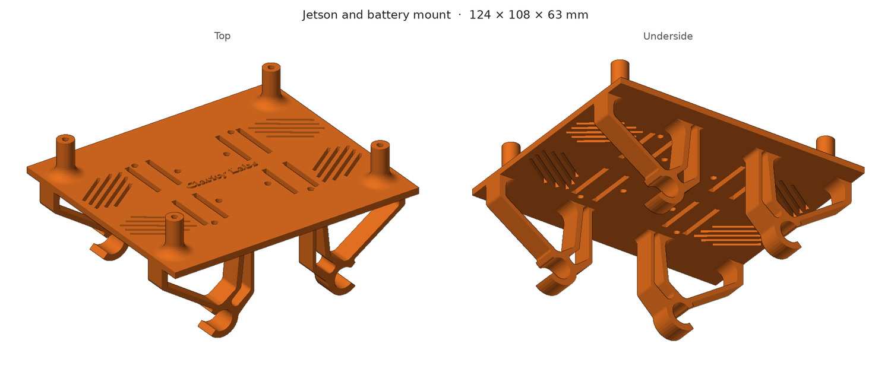

# CAD

The mount that holds the Jetson and the battery under the drone. It clips onto the frame tubes, so it goes on and
comes off without tools.

| File | What it is |
|---|---|
| [`jetson_battery_mount.SLDPRT`](jetson_battery_mount.SLDPRT) | SolidWorks part. Edit this one |
| [`jetson_battery_mount.STL`](jetson_battery_mount.STL) | Mesh for slicing and printing. Click it on GitHub for a 3D preview |

Overall size: **124 × 108 × 63 mm**.

If you change the part in SolidWorks, export a new STL over the old one so the two stay in step.
